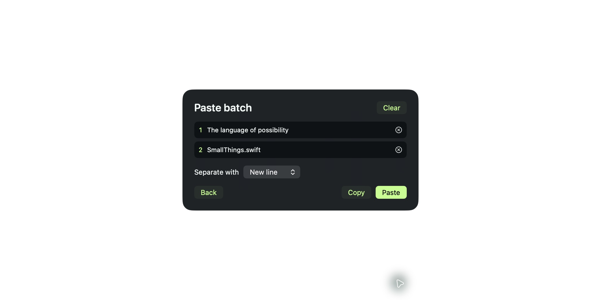
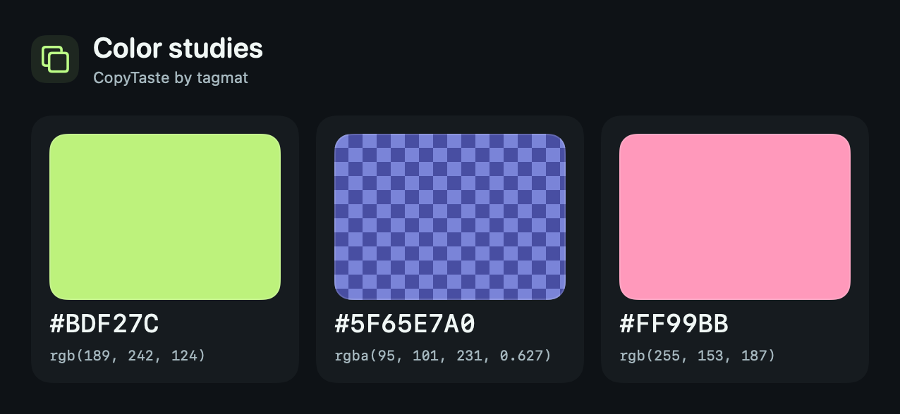

# CopyTaste

**CopyTaste by tagmat** is a native, open source clipboard utility for macOS. It lives in the menu bar. Press **⇧⌘V** and your clips spread into a floating card orbit: search, move through the cards, pin a favourite and paste it into the app you came from.

History stays in RAM by default. Capture starts only after you enable it. The menu-bar icon opens quick settings; the gear opens advanced settings when you need them.


*The default layout keeps pins on the left and recent clips on the right. All screenshots use fictional sample clips in an isolated preview session.*

| Keep close | Move quickly | Choose what stays |
| --- | --- | --- |
| Pinned clips on the left, newest copies on the right | Scroll, search, use arrow keys, then Return to paste | RAM by default; encrypted local, folder or iCloud options |
| Image, PDF and file thumbnails | Spring-driven cards with depth and a fly-away selection | Private-app exclusions, secret filters and retention |
| Markdown previews and syntax-coloured code | Menu-bar bubble for everyday controls | No accounts, analytics or remote preview requests |


*A looping sequence of application screenshots. Each frame uses sample data and is reencoded without source metadata.*

## Run

The app runs on macOS 14 or later. Building requires Xcode 16.3 or later for the macOS 15.4 pasteboard API. No third-party packages are needed.

```sh
./scripts/build-app.sh --universal
open dist/CopyTaste.app
```

The build creates `dist/CopyTaste.app` and a clean `dist/CopyTaste-macOS.zip` with arm64 and x86_64 slices. Move the app to Applications for regular use. The local build is ad-hoc signed; public distribution needs Developer ID signing and notarisation. See [distribution](docs/DISTRIBUTION.md).

The menu-bar bubble offers **Try sample clips**. Samples use an isolated pasteboard and never post paste events. You can also run:

```sh
open -n dist/CopyTaste.app --args --demo
```

## A smaller desktop workflow

- **⇧⌘V:** open or close the floating selector from another app.
- **Type:** search text, titles, source apps and file names.
- **Scroll or arrow keys:** move through the cards; **Return:** paste the selected clip.
- **Option-Return:** copy without automatic paste. **Escape:** dismiss.
- **Command-P:** pin or unpin the selection. Each card also has a pin button.
- **Command-1 through Command-9:** paste one of the nine newest matching clips. Cards show their shortcut.
- **Command-E:** edit the selected clip or rename an image or file. **Command-N:** create a text snippet.
- **Command-B:** add or remove the selected text or link in the current batch. Open **Batch** to review the order, choose a separator and paste or copy it as one block.
- Filter All, Pinned, Text, Links, Images, Files or Colors. The **Folders** menu narrows any filter to a folder or to Unfiled.
- Right-click a card to copy, move it to a folder or delete it.

Change or turn off the global shortcut in **Advanced Settings → On your Mac**. The menu bar still opens the selector.

Enable **Search text in images** in **Privacy & capture** to recognise text from up to 60 recent images using Vision on your Mac. Results are searchable while the selector is open. The temporary index stays in memory and is discarded with the selector. A batch holds up to 12 text clips or links. Closing the selector or switching away clears the batch and any unsaved draft.

The default **Pinned + recent** layout keeps a small pin stack on the left and chronological cards on the right. Open **Show all pins** for the complete pinned collection. Choose **Single orbit** in the menu-bar bubble or advanced settings to combine everything in one chronological stream. Wheel and trackpad gestures move selection while the selector is open.

Cards fan out with staggered springs, respond to pointer movement, move through depth when selection changes and fly away on choosing. Reduce Motion removes the flight, tilt and scale animations. Controls keep a dark substrate so text remains readable over bright or dark desktops.

<details>
<summary>Quick settings, file previews and batch paste</summary>




</details>

## Direct paste

**Paste on selection** is enabled by default. Open the menu-bar bubble and check **Accessibility**. Choose **Allow…** to request access when needed. CopyTaste only sends Command-V to the original destination process after checking permission, secure input, activation and session validity.

If access is missing, a destination disappears or focus changes, the item is copied for manual paste. If another copy replaces it while the destination activates, CopyTaste preserves the newer clipboard and cancels the paste. The sample selector never activates a destination or sends keyboard events. Real destination support depends on the receiving app and the selected content type.

Quick and advanced settings refresh **Accessibility** and **Clipboard access** while visible. On macOS 15.4 or later, clipboard access shows the system setting for reading copies from other apps. If it is blocked, new clips are skipped. Check the Paste from Other Apps setting in macOS Privacy & Security. On earlier macOS versions the clipboard status is unavailable.

## Images, files and small previews

Version 0.2 fixes mixed clipboard items: real PNG/TIFF/JPEG/HEIC/GIF/WebP/BMP image data takes precedence over accompanying URL or text. Image capture is enabled in 0.2, including the migration from 0.1's disabled default. An explicit opt-out made in 0.2 survives relaunch. Disabling image capture skips a mixed image item completely instead of silently retaining its URL. A URL-only copy remains a link; the app never downloads the remote image.

Files are supported up to **8 MB per file**, within the **24 MB history budget**. Image files and PDFs show small thumbnails; UTF-8 text files show an excerpt; other types, including documents and archives, show the system file-type icon, name and size. A file is pasted as a file URL, not as its filename text.

Markdown clips and `.md` files preview headings, emphasis, lists, quotes and fenced code. Recognised source files and code-like clips colour keywords, strings, comments, numbers and function calls. Formatting is a bounded preview rather than a full editor or language parser. Links are inert, remote images are never loaded, and code is never executed.

Plain text previews are bounded and the full saved text remains available for pasting.

## Colors and folders

Standalone `#RGB`, `#RGBA`, `#RRGGBB` and `#RRGGBBAA` values appear in **Colors**. Six-character codes such as `BDF27C` also work without the prefix. Add `#` when the code contains only digits, since automatic capture excludes possible verification codes. Cards display expanded hex and CSS RGB values, with a checkerboard behind transparent swatches. Right-click a card to copy either format. Return still pastes the original text.



Open **Folders** to browse by name or see **Unfiled** clips. Create a folder in the menu or choose **Move to Folder → New Folder…** from a clip to create and file it in one step. Choose a folder to rename or remove it. Removing a folder moves its clips to **Unfiled**. Existing collections appear as folders.

Files are captured one at a time. Directories, symlinks, multi-file copies, common key/vault formats and sensitive filenames are skipped. Recognised text files also pass the secret filter and 512 KiB text limit. Binary documents and images are not scanned for every possible secret; exclude sensitive applications and pause capture for private workflows.

File contents stay in RAM or the chosen encrypted history. **Pasting or copying a file creates an owner-only temporary transfer file** for the destination. It expires after five minutes, and Clear History, lock and quit remove it sooner. That on-demand transfer is separate from history persistence. Clipboard output is otherwise cleared after 45 seconds by default, only if nothing newer replaced it.

## Choose what stays

| Setting | Storage | On quit or manual app lock |
| --- | --- | --- |
| Memory only — default | Process memory | Session discarded |
| Encrypted on this Mac | AES-256-GCM in Application Support | Saved history remains encrypted |
| Encrypted in a folder | AES-256-GCM in your chosen folder | Saved history remains encrypted |
| iCloud Drive sync | Shared passphrase-encrypted file | Synced history remains encrypted |
| Save pinned items only | Optional rule for local encrypted vaults | Other clips are discarded |

Entries expire after 7 days by default, including pins. Choose 1, 7 or 30 days and 100, 300 or 1,000 clips. **Keep pins past expiry** skips the age limit for pins and gives them priority within the count and byte limits. Match this choice across Macs sharing an iCloud vault. Expiration runs during use and on reopening. Memory mode clears pins and collections on manual app lock or quit. macOS may page memory to disk, so use FileVault to protect your Mac.

Screen lock and sleep pause capture and keep the session in RAM by default. After the Mac is unlocked and awake, CopyTaste resumes your previous Capture setting and skips copies made during the pause. In **Advanced Settings → Privacy & capture**, enable **Clear history when Mac locks or sleeps** to clear the session instead. With this option, memory capture restarts after you return, while saved vaults require app authentication. **Lock & Clear Memory** always clears the session and requires manual unlocking.

Local vaults use a non-synchronising Keychain key. Opening saved history requires Mac authentication. A copied local vault requires the original keychain; losing that key loses access. Apply storage changes explicitly. The new vault is written before the old active local vault is removed. Backups and filesystem snapshots cannot be revoked by the app.

## iCloud sync

In advanced settings, choose **iCloud Drive · encrypted sync**, enter a unique phrase of at least 16 characters and use the same phrase on every Mac. iCloud Drive must already be enabled in macOS. Update all participating Macs to 0.2 before syncing file entries.

Clips, files, pins and collections are merged through `iCloud Drive/CopyTaste/history.copytaste`. Data is encrypted before writing using AES-256-GCM and a PBKDF2-HMAC-SHA256 key (600,000 iterations, random salt). The phrase is not saved and cannot be recovered. Enter it after a manual app lock, session clearing or restart.

While open and unlocked, CopyTaste checks for merges every six seconds. A failed merge keeps changes in bounded memory and retries with increasing delays. Advanced settings show the issue, whether changes are waiting and the last successful local merge. Use **Sync Now** to retry immediately. Manual app lock, optional session clearing or quit discards pending changes that could not be written. If an existing vault is missing when reopened, restore it in iCloud Drive first.

Deletions prevent stale peers restoring removed items. macOS handles network delivery, and a local merge time only reports the local file operation. Disconnecting leaves the shared encrypted file for other Macs. Screen lock pauses capture and sync. Manual app lock also unloads the session.

The merge and encryption protocol is tested with isolated temporary files. Live delivery, account access and iCloud conflict handling still need two-Mac validation. There are no app accounts, analytics, remote previews, content logs or custom sync servers.

## Privacy and development

Private clipboard markers, credential applications, secure input, uncertain source transitions and common secret patterns are excluded before persistence. Source attribution is best effort; macOS does not authenticate every clipboard writer. Read [SECURITY.md](SECURITY.md) for the exact boundaries.

```sh
./scripts/test.sh
./scripts/build-app.sh --universal
```

Tests use synthetic content, private named pasteboards and temporary files. They never access the general clipboard, Keychain or real iCloud account, and direct-paste tests inject an event sink rather than sending real input. See [testing](docs/TESTING.md), [architecture](docs/ARCHITECTURE.md) and [contributing](CONTRIBUTING.md).

Screenshot exports are produced from the isolated sample session. `scripts/sanitize-readme-image.swift` reencodes PNG pixels, and `scripts/make-readme-gif.swift` assembles the illustrated tour without carrying capture metadata.

[MIT License](LICENSE). © 2026 tagmat.
